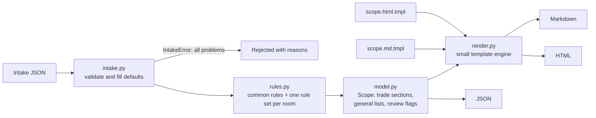

# scope-of-work-generator

Remodel scopes written from memory drift: one job lists the exclusions, the next forgets them, and the gap turns into a dispute.
This tool turns a short structured intake into the same complete, trade by trade scope every time.

## What it does

- Takes a small JSON intake for a **bathroom**, **kitchen** or **basement** remodel: room size, finish tier, year built, who pulls permits, who does demolition, and six to nine room specific choices.
- Validates the intake and reports every problem at once (unknown fields, out of range sizes, combinations that cannot be built).
- Applies deterministic rules to produce a scope grouped by trade, in the order work happens on site. Each trade gets its own **inclusions**, **exclusions**, **assumptions** and **allowances**.
- Adds project wide exclusions and assumptions, an allowance roll up, and a "review before sending" checklist for anything a person should confirm first (pre 1978 home, basement bedroom with no egress window, gas range in a changed layout, and so on).
- Renders the result to Markdown and HTML from template files, or to JSON.

There is no model call, no network access and no randomness. The same intake always produces byte identical output. It has no dependencies beyond the Python standard library (3.10 or newer).

## Architecture



| Path | Role |
| --- | --- |
| `sowgen/intake.py` | Intake fields, per room options, validation, cross field checks |
| `sowgen/rules.py` | The rules: common start and end, then bathroom, kitchen, basement |
| `sowgen/model.py` | `Scope`, `TradeSection`, `Allowance`, and the flat context handed to templates |
| `sowgen/render.py` | A small template engine (`{{ value }}`, `for`, `if`/`else`) and the two renderers |
| `sowgen/templates/` | `scope.md.tmpl` and `scope.html.tmpl`; edit these to change wording or layout |
| `sowgen/cli.py` | `python -m sowgen` |
| `examples/` | One synthetic intake per room type |
| `demo/` | Offline demo script, its captured output, and the rendered samples |

## Run it

```bash
git clone <this repo> && cd scope-of-work-generator
python -m sowgen examples/bathroom.json
python -m sowgen examples/kitchen.json --format both --out out
```

Nothing to install. Other useful forms:

```bash
python -m sowgen --describe                              # list every intake field and option
python -m sowgen examples/basement.json --format html    # HTML to stdout
python -m sowgen examples/basement.json --format json    # the structured scope
```

An invalid intake exits with status 2 and prints each problem on its own line.

### Intake example

```json
{
  "project_id": "DEMO-BATH-001",
  "room_type": "bathroom",
  "area_sqft": 48,
  "finish_tier": "standard",
  "year_built": 1965,
  "permit_by": "contractor",
  "options": { "shower": "walk_in_shower", "heated_floor": true, "exhaust_fan": "new" }
}
```

Anything left out takes a documented default. The optional `SOWGEN_COMPANY_NAME` environment variable sets the "Prepared by" line (see `.env.example`); there are no secrets and no required configuration.

## Tests

```bash
python -m unittest discover -s tests -t . -v
```

67 tests, standard library only. They cover intake validation, each room type's rules (trade order, toggles, allowance arithmetic, review flags), the template engine, both renderers, the CLI, and a sweep that builds and renders every valid option combination for all three rooms (about 2,400 scopes). CI runs the same command on Python 3.10 and 3.12, then runs the demo and checks the committed samples are current.

## Demo

```bash
python demo/run_demo.py
```

The demo builds scopes from the three example intakes, writes Markdown and HTML to `demo/sample_output/`, prints one full scope, shows a rejected intake, and confirms the output is repeatable. The captured run is in [`demo/output.txt`](demo/output.txt). An excerpt:

```text
DEMO-BSMT-003  basement, 720 sq ft, basic tier
  trades: 12  inclusions: 28  exclusions: 8  assumptions: 7  allowances: 6 (total $6,280)
  review: Moisture history reported: get the source and the fix in writing before finishing walls.
  review: Basement bathroom: confirm the under slab rough in exists. If not, slab work and an ejector pump must be added.
  review: Bedroom without a new egress window: verify the existing opening meets egress size and sill height, or the room cannot be listed as a bedroom.
```

Rendered samples: [bathroom](demo/sample_output/DEMO-BATH-001.md), [kitchen](demo/sample_output/DEMO-KITCH-002.md), [basement](demo/sample_output/DEMO-BSMT-003.md), each with an `.html` twin in the same folder.

All data in this repository is synthetic. Client and site labels are placeholders and the dollar figures are invented.

## Where this pattern runs

This is drawn from systems that run two small service companies day to day, where a scope has to go out quickly, read the same way no matter who prepared it, and state plainly what is not included. The pattern is a short intake, rules a tradesperson can read and correct, and templates that keep wording out of the code. This repository is a clean, generic rebuild of that pattern with invented rules and numbers.

## Limitations

- **Not a price.** Allowance amounts are illustrative placeholders, not market rates, and there is no labor, markup or tax. The total is a sum of allowances only.
- **Not code compliance or legal advice.** Lines that mention permits, egress, GFCI protection or lead safe practices are generic prompts. Local codes differ and a qualified person must review every scope before it is sent. The review checklist helps with that but is not exhaustive.
- **Three room types, one room per intake.** No whole house jobs, additions, exteriors or multi room projects.
- **Quantities are estimates from one number.** Tile, countertop and backsplash areas are derived from the room size or cabinet run with fixed assumptions (for example 90 sq ft of wall tile for a walk in shower), not from a field measure.
- **Rules live in Python.** Changing scope logic means editing `rules.py` and its tests. Wording that sits in the templates can be changed without touching code, but the individual scope lines cannot.
- **The template engine is minimal.** It supports value lookup, `for` and `if`/`else` only. Markdown output is not escaped, so intake text containing Markdown characters or `|` will pass straight through. HTML output is escaped.
- **English only, US units and terms.**

License: MIT, see the LICENSE file.
