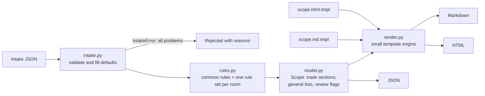

# scope-of-work-generator

**The problem:** remodel scopes written from memory drift. One job lists the exclusions, the next forgets them, and the gap turns into a dispute over who was supposed to pay for what.

**Who it is for:** a remodeling contractor or estimator who sends bathroom, kitchen and basement scopes and wants every one to read the same way, whoever prepared it.

**What it does:** you fill in a short intake (room size, finish tier, year built, who pulls permits, who does demolition, and six to nine room specific choices). It gives back a complete scope of work, grouped by trade in roughly the order work happens on site. Every trade states its **inclusions**, **exclusions**, **assumptions** and **allowances**. On top sits a "review before sending" checklist for things a person should confirm first: a pre 1978 home, a basement bedroom with no egress window, a gas range in a changed layout.

The same intake always produces the same document. A bad intake is rejected with every problem listed, not just the first.

**How it is built:** plain Python (3.10 or newer), standard library only. The rules are ordinary `if` statements a tradesperson can read and correct. There is no AI model call, no network access and no randomness. Output is Markdown, HTML or JSON.

This is a working demonstration with invented rules and placeholder dollar figures, not a pricing tool. See [Limitations](#limitations).

## What you will see

Real output from `python demo/run_demo.py`, copied from [`demo/output.txt`](demo/output.txt). The summary for the basement example:

```text
DEMO-BSMT-003  basement, 720 sq ft, basic tier
  trades: 12  inclusions: 28  exclusions: 8  assumptions: 7  allowances: 6 (total $6,170)
  review: Moisture history reported: get the source and the fix in writing before finishing walls.
  review: Basement bathroom: confirm the under slab rough in exists. If not, slab work and an ejector pump must be added.
  review: Bedroom without a new egress window: verify the existing opening meets egress size and sill height, or the room cannot be listed as a bedroom.
```

One trade from the bathroom scope, as rendered:

```markdown
### 8. Tile and waterproofing

**Inclusions**

- Waterproof membrane on wet walls, about 90 sq ft.
- Wall tile at the tub or shower to ceiling height.
- Waterproofed shower pan with flood test before tile.
- Floor tile over uncoupling membrane, about 48 sq ft.

**Exclusions**

- Natural stone, mosaic or patterned layouts unless priced separately.

**Assumptions**

- Tile areas are estimated from the room size and confirmed by field measure.

**Allowances**

| Item | Basis | Allowance |
| --- | --- | ---: |
| Glass shower enclosure | one standard size panel and door, installed | $1,400 |
| Tile material | 138 sq ft plus 10% waste | $1,070 |
```

And a deliberately bad intake:

```text
  - area_sqft for a bathroom must be between 20 and 200
  - finish_tier must be one of basic, standard, premium
  - unknown bathroom option: sauna
  - options.heated_floor requires options.floor to be tile
```

Full rendered samples: [bathroom](demo/sample_output/DEMO-BATH-001.md), [kitchen](demo/sample_output/DEMO-KITCH-002.md), [basement](demo/sample_output/DEMO-BSMT-003.md), each with an `.html` twin in the same folder.

## Run it

```bash
git clone https://github.com/midcityhandyman/scope-of-work-generator.git
cd scope-of-work-generator
python -m sowgen examples/bathroom.json
python -m sowgen examples/kitchen.json --format both --out out
```

Nothing to install: run it from the repository folder. Other useful forms:

```bash
python -m sowgen --describe                              # list every intake field and option
python -m sowgen examples/basement.json --format html    # HTML to stdout
python -m sowgen examples/basement.json --format json    # the structured scope
```

An invalid intake exits with status 2 and prints each problem on its own line. If you would rather have a `sowgen` command on your path, `pip install .` inside a virtual environment provides one.

### Intake example

```json
{
  "project_id": "DEMO-BATH-001",
  "room_type": "bathroom",
  "area_sqft": 48,
  "finish_tier": "standard",
  "year_built": 1965,
  "permit_by": "contractor",
  "options": { "shower": "walk_in_shower", "heated_floor": true, "exhaust_fan": "new" }
}
```

Anything left out takes a documented default. The optional `SOWGEN_COMPANY_NAME` environment variable sets the "Prepared by" line (see `.env.example`); there are no secrets and no required configuration.

## How it works



| Path | Role |
| --- | --- |
| `sowgen/intake.py` | Intake fields, per room options, validation, cross field checks |
| `sowgen/rules.py` | The rules: common start and end, then bathroom, kitchen, basement |
| `sowgen/model.py` | `Scope`, `TradeSection`, `Allowance`, and the flat context handed to templates |
| `sowgen/render.py` | A small template engine (`{{ value }}`, `for`, `if`/`else`) and the two renderers |
| `sowgen/templates/` | `scope.md.tmpl` and `scope.html.tmpl`; edit these to change wording or layout |
| `sowgen/cli.py` | `python -m sowgen` |
| `examples/` | One synthetic intake per room type |
| `demo/` | Offline demo script, its captured output, and the rendered samples |

## Tests

```bash
python -m unittest discover -s tests -t . -v
```

72 tests, standard library only. They cover intake validation, each room type's rules (trade order, toggles, allowance arithmetic, review flags), the template engine, both renderers, the CLI, and a sweep that builds and renders every valid option combination for all three rooms at one fixed size and the default tier (2,384 scopes). CI runs the same command on Python 3.10 and 3.12 on Linux, then runs the demo and fails if the committed demo output or samples are out of date.

## Demo

```bash
python demo/run_demo.py
```

The demo builds scopes from the three example intakes, writes Markdown and HTML to `demo/sample_output/`, prints one full scope, shows a rejected intake, and confirms the output is repeatable. The captured run is in [`demo/output.txt`](demo/output.txt).

All data in this repository is synthetic. Client and site labels are placeholders and the dollar figures are invented.

## Where this pattern comes from

The author runs small service businesses where a scope has to go out quickly, read the same way no matter who prepared it, and state plainly what is not included. The pattern is a short intake, rules a tradesperson can read and correct, and templates that keep wording out of the code. This repository is a generic rebuild of that pattern, written for demonstration. It is not the code those businesses use, and its rules and numbers are invented.

## Limitations

- **Nothing here has been used on a real job.** No scope from this repository has been sent to a client, and the rules have not been reviewed by a licensed plumber, electrician or code official. The only inputs it has ever run on are the three synthetic examples and the test sweep.
- **No integrations, so nothing is mocked.** It reads a JSON file and writes text. It does not connect to an estimating package, a CRM, e-signature or email, and it does not produce PDF. Getting a scope to a client is a manual step.
- **Not a price.** Allowance amounts are illustrative placeholders, not market rates, and there is no labor, markup or tax. The total is a sum of allowances only.
- **Not code compliance or legal advice.** Lines that mention permits, egress, GFCI protection or lead safe practices are generic prompts. Local codes differ and a qualified person must review every scope before it is sent. The review checklist helps with that but is not exhaustive.
- **Three room types, one room per intake.** No whole house jobs, additions, exteriors or multi room projects.
- **Quantities are estimates from one number.** Tile, countertop and backsplash areas are derived from the room size or cabinet run with fixed assumptions (90 sq ft of wall tile for a walk in shower, a 15 sq ft island top, a 40 sq ft basement bathroom floor), not from a field measure. The cabinet run is not checked against the room size.
- **Some combinations are flagged, not resolved.** A kitchen layout change with a gas range, or an island added while the existing countertops stay, produces a review flag and an exclusion. The tool does not work out the missing line item for you.
- **Trade order is fixed and approximate.** Every job gets the same sequence. It does not schedule work or split rough and finish visits.
- **Rules live in Python.** Changing scope logic means editing `rules.py` and its tests. Wording that sits in the templates can be changed without touching code, but the individual scope lines cannot.
- **The template engine is minimal.** It supports value lookup, `for` and `if`/`else` only. Markdown output is not escaped, so intake text containing Markdown characters or `|` will pass straight through. HTML output is escaped.
- **English only, US units and terms.**

License: MIT, see the LICENSE file.
